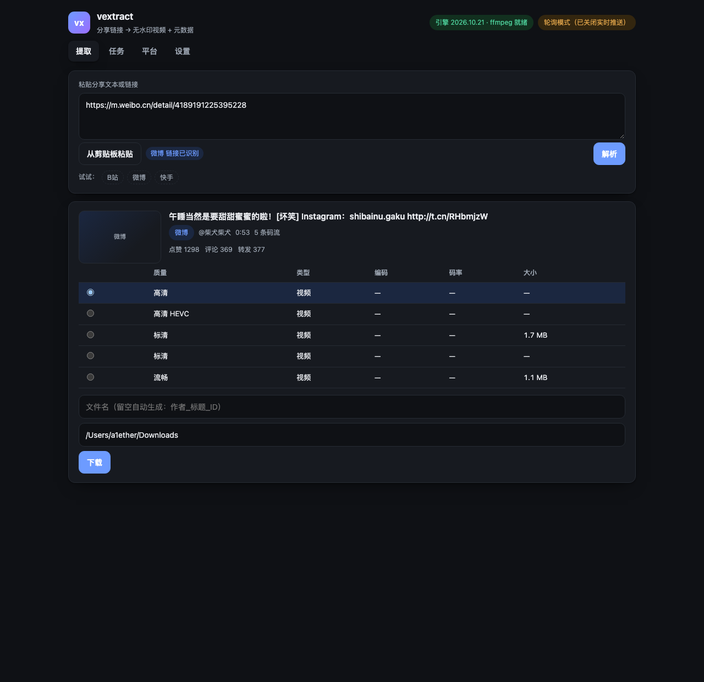

# vextract

自媒体提取工具：**贴一个分享链接/分享文本，拿到的可以是视频、仅音频、图集，甚至文字稿**。

- **视频**：无水印源文件 + 元数据（默认）
- **仅音频**：m4a / mp3 / flac，源已经是目标编码时零重编码，可写入标题/作者标签
- **图集**：图文作品的图片，落成 `01.jpg / 02.jpg …` 的同名文件夹
- **本地转录**：音频 → 文字稿（md / txt / srt），完全离线、不依赖平台登录态

覆盖 抖音 / 快手 / 小红书 / B站 / 微博 / YouTube / TikTok，以及 yt-dlp 支持的 1700+ 站点。

> 技术选型与代码复用策略见 [`docs/01-技术调研与选型方案.md`](docs/01-技术调研与选型方案.md)，
> 实现与验收记录见 [`docs/02-实现与验收.md`](docs/02-实现与验收.md)，
> 拓展能力（音频/图集/转录）的实测证据见 [`docs/03-拓展能力（音频·图集·本地转录）.md`](docs/03-拓展能力（音频·图集·本地转录）.md)。
> 文档里的每条"支持/不支持"都带本机实测证据——本项目**不采信上游 README 的自述**。



## 快速开始

```bash
uv sync                # 安装依赖（Python 3.12，由 uv 管理）
uv run vx serve        # 启动服务并自动打开浏览器
```

浏览器里就做完了全部操作：**粘贴分享文本 → 解析 → 选清晰度 → 下载 → 看进度 → 页面内播放**。
默认地址 <http://127.0.0.1:8787/>，`vx serve --no-open --port 9000` 可改端口。

> 端口被占用时会**自动让位到下一个空闲端口**并在终端打印提示（含占用者进程名），
> 而且浏览器**只在服务真正监听、且探活确认是本程序之后**才打开——
> 早期版本因为"先开浏览器、后启动服务"，曾把用户送到占用 8000 端口的别的程序页面上。

### 界面里能做的事

| 页 | 功能 |
|---|---|
| **提取** | 粘贴/一键读剪贴板；识别平台；展示封面、标题、作者、时长、互动数；**产物模式（视频 / 仅音频 / 图集）**；码流表（默认选最高清晰度，可改）；音频格式与**本地转录**勾选；图文作品显示图集网格；自定义文件名与输出目录；建下载任务 |
| **任务** | 实时进度（阶段 + 字节 + 百分比）、取消、重试、**页面内试听/播放**（支持拖动进度）、图集缩略图（点开原图）、保存文字稿、保存文件、在访达中定位、移除、清空已完成；历史落盘，重启仍在 |
| **平台** | 能力矩阵（含本机实测状态）+ 环境自检（yt-dlp 版本、ffmpeg、cookie 就绪情况、provider 顺序） |
| **设置** | 输出目录、从浏览器读取 cookie（chrome/edge/firefox/safari…）、实时推送开关（关掉改轮询） |

### 深链（可脚本化）

```bash
# 打开就解析
open "http://127.0.0.1:8787/?text=https%3A%2F%2Fm.weibo.cn%2Fdetail%2F4189191225395228"
# 打开就解析并直接开始下载
open "http://127.0.0.1:8787/?text=<分享文本>&download=1"
# 强制轮询（脚本/无头环境里 SSE 会挂住页面加载）
open "http://127.0.0.1:8787/?live=0"
```

也可以做成 shell 别名：

```bash
alias vxg='open "http://127.0.0.1:8787/?text=$(python3 -c "import urllib.parse,sys;print(urllib.parse.quote(sys.stdin.read()))")"'
```

## 产物模式

| 模式 | 产物 | 说明 |
|---|---|---|
| 视频 | `<作者>_<标题>_<ID>.mp4` | DASH 平台（B站/YouTube）自动 ffmpeg 无损合并 |
| 仅音频 | `.m4a` / `.mp3` / `.flac` | DASH 平台直接下自带音轨；单文件 mp4 平台用 ffmpeg 抽。**源已是 aac 且要 m4a 时不重编码**；默认把标题/作者/原链接写进标签（`--no-tags` 关掉） |
| 图集 | `<作者>_<标题>_<ID>/01.jpg…` | 图文作品（微博实测 18 张；抖音/小红书解析已实现、待线上正例） |
| 字幕 | `<同名>.<语言码>.srt` | B站 CC/AI 字幕（**需登录态**，匿名恒为空）。`--subs auto` 按偏好挑一条，或 `--subs zh-CN,en-US` 指定；没有字幕时可以直接用本地转录生成 |
| 本地转录 | `<同名>.md/.txt/.srt` | 音频落盘后跑本地 ASR；`--transcribe` 开启，需可选依赖（见下）。非人声素材（纯音乐/环境音）会让 Whisper 陷入重复循环，这时换 `--asr-backend faster_whisper`（自带 VAD） |

```bash
# 只要音频（mp3）
uv run vx get "<分享文本>" --mode audio --audio-format mp3
# 音频 + 中文文字稿
uv run vx get "<分享文本>" --mode audio --transcribe --asr-language zh
# 非人声素材（音乐/环境音）换 faster-whisper：自带 VAD，会先剔掉无人声段
uv run vx get "<分享文本>" --mode audio --transcribe --asr-backend faster_whisper --asr-model small
# 图文作品（也可以不给 --mode：图文会自动推断成图集）
uv run vx get "<图文分享文本>" --mode images
# 顺带存字幕（B站 CC 字幕要登录态；可先从浏览器只读 cookie）
uv run vx get "<B站链接>" --cookies-from-browser chrome --subs zh-CN
uv run vx get "<B站链接>" --subs auto --mode audio
```

本地转录依赖是**可选**的，不装也能用其它模式：

```bash
uv sync --extra transcribe        # 跨平台、体积小（faster-whisper / CTranslate2）
uv sync --extra transcribe-mlx    # Apple Silicon 最快；mlx-whisper 连带 torch，实测 .venv 约 1.3GB
```

模型权重首次使用会下载（默认 `large-v3-turbo` 约 1.6GB，`vx doctor` 会显示当前后端与模型）；
国内可 `export HF_ENDPOINT=https://hf-mirror.com`。**字幕为什么不走平台**：国内平台的 CC 字幕是
登录态产物（实测 B站匿名 `need_login_subtitle=true`、`subtitles=[]`；抖音 web 详情没有字幕轨），
本地 ASR 反而与平台改版无关——证据见 docs/03。

## 命令行 / HTTP

CLI 保留完整能力，适合批处理与调试：

```bash
uv run vx doctor        # 自检：引擎 / ffmpeg / ffprobe / cookie / 本地转录后端
uv run vx platforms     # 平台能力矩阵
uv run vx cookies import <导出文件> --platform douyin   # 把浏览器插件的导出落成 cookie 文件（Netscape / 0600）
uv run vx cookies show douyin                           # 看当前用的是哪份（只列 cookie 名，不打印值）
uv run vx info "<分享文本>"            # 只解析（图集会列出张数/尺寸）
uv run vx get  "<分享文本>" -o ~/Downloads
uv run vx get  "<分享文本>" --mode audio --transcribe    # 音频 + 本地文字稿
uv run vx get  "<链接>" -q audio                        # -q audio 等同 --mode audio
```

HTTP（前端用的就是这套）：

```bash
curl -s localhost:8787/health
curl -s -X POST localhost:8787/extract -H 'content-type: application/json' \
  -d '{"text":"https://m.weibo.cn/detail/4189191225395228"}'
curl -s -X POST localhost:8787/tasks   -H 'content-type: application/json' \
  -d '{"text":"<分享文本>","stream_index":1}'
curl -s -X POST localhost:8787/tasks   -H 'content-type: application/json' \
  -d '{"text":"<分享文本>","mode":"audio","audio_format":"mp3","transcribe":true,"transcript_format":"md"}'
curl -s -X POST localhost:8787/tasks   -H 'content-type: application/json' \
  -d '{"text":"<图文分享文本>","mode":"images"}'
curl -N localhost:8787/events          # SSE：任务状态与进度
curl -s -o 01.jpg 'localhost:8787/tasks/<id>/artifact?index=0'   # 图集的第 1 张
curl -s -o 文字稿.md 'localhost:8787/tasks/<id>/artifact?index=0&attachment=1'  # 音频任务里的文字稿
```

## 平台能力（截至 2026-10-25 实测）

| 平台 | 解析方式 | 鉴权 | 需要 ffmpeg 合并 | 图文（图集） / 字幕 |
|---|---|---|---|---|
| B站 | 自研（WBI 签名 + playurl） | 可选，SESSDATA 解锁 1080P+ **与字幕** | **是**（DASH 分离）；音频模式自带纯音轨 | 字幕 ✅ 登录态实测 12/2/1 轨 |
| 微博 | 自研（游客墙 + statuses/show） | 免登录 | 否 | ✅ 实测 18 张图（`pic_infos` 7 档，按面积取最大） |
| 快手 | 自研（移动页 `window.INIT_STATE`） | 公开作品免登录 | 否 | — |
| 小红书 | 自研（`__INITIAL_STATE__`） | 需分享文本里的 `xsec_token` | 否 | ⚠️ 解析实现 + fixture 覆盖，待一条未失效链接 |
| 抖音 | 自研（详情接口 + 本机算签名） | **需要一次浏览器身份 UIFID**，之后复用 | 否 | ✅ 实测 8/10 条有图（`url_list` 无水印） |
| YouTube/TikTok | yt-dlp | 可选 | YouTube 是 | — |
| 视频号 | 未实现（见 P2） | 需 MITM 证书 + 系统代理 | — | — |

**B站匿名只能拿 480P**（实测：接口声明到 1080P+，`dash.video` 实际只有 360P/480P）。
要高清就导出浏览器 cookie（Netscape 格式）放到 `~/.config/vextract/cookies/bilibili.txt`，
或在「设置」里选择"从浏览器读取 cookie"。

**抖音：需要一次浏览器身份，之后不用再管。** 风控（Argus）在详情接口上要三样东西：

1. `UIFID` —— 浏览器的持久访客 ID，**只能由真实浏览器产生**（首页/详情/分享页都不会下发）；
2. `ttwid` —— 游客令牌，可以自造，工具会自动去 `ttwid.bytedance.com` 免费注册并缓存；
3. `x-secsdk-web-signature` —— 32 位 md5，是 `UIFID + 时间戳 + 固定 salt + query` 的纯函数，
   本机算得出来，**不需要 a_bogus**（那套 849 行 VM 逆向代码在这里不是必需项）。

所以只要给一次 UIFID，之后就永远不用再碰 cookie 了：

```bash
uv run vx cookies import ~/Downloads/douyin-cookies.json --platform douyin   # 一次
uv run vx get "https://www.douyin.com/video/<id>"                            # 之后随便跑
# 或者完全不导入文件，直接让它读你本机浏览器：
uv run vx get "<链接>" --cookies-from-browser chrome
```

实测产物：`h264 1080x1920 + aac`，19.73s，6.0 MB，**无水印**；分档 1080p / 720p / 540p / 540p 低码率。
唯一没省掉的一步就是那一次 UIFID —— 它不是 cookie 登录态，只是设备指纹，但服务端确实
只认浏览器造出来的那份（本地任何 HTTP 入口都拿不到，已实测）。

## 设计要点

- **前端就是产品**：`vx serve` 一条命令，FastAPI 直接托管内置前端（无构建步骤、无 CDN 依赖，离线可用）。
- **一个平台一个文件**：`src/vextract/providers/*.py`，实现 `matches()` + `resolve()` 两个方法，
  注册表自动发现，新增平台不改任何路由、前端或 CLI 代码。
- **统一中间表示**：所有 provider 产出 `MediaInfo`，前端/CLI/下载器完全不感知平台差异。
- **错误带 code + hint**：`AUTH_REQUIRED` / `RATE_LIMITED` / `UPSTREAM_CHANGED` / `NO_MEDIA` …
  前端把 hint 原样呈现（"你下一步该做什么"），HTTP 返回机器可读 code。
- **cookie 阶梯不静默重试**：无 cookie → 报错并给出两条具体路径，绝不偷偷降级。
- **SSR JSON 容错集中在一处**：`parsers.py` 处理 `undefined` / `new Map([])` / `new Set([])` /
  C1 控制字符 / 尾逗号——平台改版时只改这一个文件。
- **任务队列 + SSE**：进度推送与取消都走同一份 `Progress` 回调（CLI 的进度条复用同一实现）；
  SSE 不可用时前端自动降级为轮询。

## 开发

```bash
uv run pytest              # 离线测试（含前端 HTML/JS/路由一致性检查，不碰网络）
uv run pytest -m live      # 真机测试（会访问真实平台）
uv run ruff check src tests scripts
uv run python scripts/capture_fixtures.py   # 平台改版时重抓 fixture
uv run python scripts/probe_extras.py       # 查证"音频/弹幕/字幕/图文"上游到底给不给数据
```

前端三个文件在 `src/vextract/web/`（`index.html` / `app.js` / `styles.css`），改完刷新即可，
`tests/test_web.py` 会检查"JS 调用的接口是否真的存在""JS 引用的 id 是否真的在 HTML 里"。

## 许可证与合规

本项目为 MIT。依赖清单只允许 Unlicense / MIT / Apache-2.0 / BSD：

- 可选转录依赖：`mlx-whisper` = **MIT**、`faster-whisper` = **MIT**、`ctranslate2` = **MIT**、`mlx` = **MIT**、
  `torch` = Apache-2.0/BSD/MIT 混合（实测 `.venv` 装上 mlx 后端后约 1.3GB）；Whisper 模型权重也是 MIT。

- 引擎 `yt-dlp` = **Unlicense**（可自由内嵌、闭源商用、无 copyleft 义务）。
- 调研中排除的项目：`XHS-Downloader` / `Bili23-Downloader` / `TikTokDownloader`（GPL-3.0）、
  `bilibili-api`（GPL-3.0，已被律师函关停）、`bilibili-API-collect`（CC BY-NC，已清空）、
  `wx_channels_download`（MIT + Commons Clause，禁售卖）。

工具仅用于个人学习与研究，请遵守各平台服务条款与著作权法，不要用于批量搬运或商业分发。